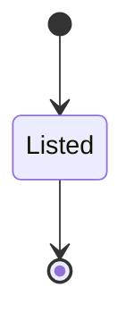
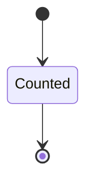
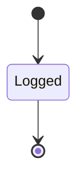
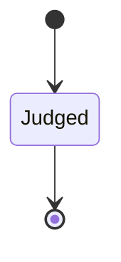

<!--
generated from agenticspec v1
contract digest slice-sha256/2:5308b20750c46621a7fd8748869c9096e65cfcb7f90c1983a7c4175d2b3f0a88
do not edit: regenerate with `ess generate`
-->

# view

What a session renderer reads: one session as agents and a flat, ordered list of view events derived from the session IR's published events, and the read models of the UI (`ui/agenticspec.ui.yaml`): sessions, agents, events and check verdicts. It holds no content, only names, counts and times, except the harness's session title, which stays in the host's local store. A renderer takes a whole document or an update that appends events; the UI reads the views and takes their changes live. The UI is written by hand (`ui/app/`) over TypeScript types generated from this domain (`ess generate types`); a gateway UI reuses its embed pages and components.

`agenticspec.view` is one of agenticspec's bounded contexts. [Back to the index](../index.md).

## Types

### `Agent`

`agenticspec.view.Agent` is a record of five fields:

- `id` — `String`
- `parent` — `Optional<String>`, which may be absent
- `role` — `String`
- `spawned_by` — `Optional<String>`, which may be absent
- `started_at` — `Integer`

### `BucketId`

`agenticspec.view.BucketId` wraps `String` and is not interchangeable with one: the whole value of naming it separately is the crossings the model then refuses.

### `CheckId`

`agenticspec.view.CheckId` wraps `String` and is not interchangeable with one: the whole value of naming it separately is the crossings the model then refuses.

### `CountId`

`agenticspec.view.CountId` wraps `String` and is not interchangeable with one: the whole value of naming it separately is the crossings the model then refuses.

### `Document`

`agenticspec.view.Document` is a record of seven fields:

- `format` — `String`
- `session_id` — `String`
- `title` — `Optional<String>`, which may be absent
- `project` — `String`
- `harness` — `String`
- `agents` — `List<agenticspec.view.Agent>`
- `events` — `List<agenticspec.view.Event>`

### `Event`

`agenticspec.view.Event` is a record of 14 fields:

- `seq` — `Integer`
- `at` — `Integer`
- `agent` — `String`
- `kind` — `agenticspec.view.EventKind`
- `label` — `String`
- `detail` — `Optional<String>`, which may be absent
- `call` — `Optional<String>`, which may be absent
- `ok` — `Optional<Boolean>`, which may be absent
- `context_tokens` — `Optional<Integer>`, which may be absent
- `output_tokens` — `Optional<Integer>`, which may be absent
- `cache_read_tokens` — `Optional<Integer>`, which may be absent
- `cache_write_tokens` — `Optional<Integer>`, which may be absent
- `cost_microdollars` — `Optional<Integer>`, which may be absent
- `bytes` — `Optional<Integer>`, which may be absent

### `EventId`

`agenticspec.view.EventId` wraps `String` and is not interchangeable with one: the whole value of naming it separately is the crossings the model then refuses.

### `EventKind`

`agenticspec.view.EventKind` is one of `agent_started`, `prompt`, `model_turn`, `tool_call`, `decision`, `tool_result`, `turn_end`, `compaction`, `exposure` and `cache_bust`.

### `SlotId`

`agenticspec.view.SlotId` wraps `String` and is not interchangeable with one: the whole value of naming it separately is the crossings the model then refuses.

### `Update`

`agenticspec.view.Update` is a record of six fields:

- `format` — `String`
- `session_id` — `String`
- `reset` — `Boolean`
- `from_seq` — `Integer`
- `agents` — `List<agenticspec.view.Agent>`
- `events` — `List<agenticspec.view.Event>`

Two of the types above are reached by nothing else in this system: `agenticspec.view.Document` and `agenticspec.view.Update`. No entity, view, command, event, error or crossing names them, so it is either vocabulary something outside this specification uses or a leftover — and only a person can tell which.

## Entities

An entity is what this context is about: something with an identity that outlives any one request, a shape, and a lifecycle. The lifecycle is exhaustive — a move that is not drawn below is a move this specification does not permit, and that is the only way it says so. Every move is labelled with the command that takes it, because a move nothing can trigger is refused rather than drawn.

### `AgentListing`

`agenticspec.view.AgentListing`.

An instance is identified by `agent_id`, a `agenticspec.session.AgentId`. The name is part of the model and not a convention: a view projects the identity under that name, so a projection inventing its own would disagree with the view.

It holds:

- `session_id` — `agenticspec.session.SessionId`
- `parent` — `Optional<agenticspec.session.AgentId>`, which may be absent
- `role` — `agenticspec.session.AgentRole`
- `model` — `Optional<String>`, which may be absent
- `started_at` — `Timestamp`
- `turns` — `Integer`
- `context_tokens` — `Integer`
- `context_max` — `Integer`
- `output_tokens` — `Integer`
- `cost_usd` — `Binary64`
- `tool_calls` — `Integer`
- `busts` — `Integer`

It references at most one [`AgentListing`](#agentlisting), as `parent_agent`, carried by `AgentListing.parent`. Its `session_id` is what [`SessionListing`](#sessionlisting) owns it by, as `agents_of`.

No invariant is declared, so nothing here constrains an instance at rest.

Its state is a `agenticspec.view.AgentListing.State`, one of `Listed`. That enum is synthesised from the lifecycle rather than declared beside it, so the states a view's filter compares and the states drawn below cannot disagree.

An instance is created in `Listed`. `Listed` is terminal, so an instance may rest there forever. That is declared rather than inferred from having no way out: an entity that cannot leave a state is either finished or stuck, and only its author knows which.

It declares no moves, so nothing changes its state once it exists.

It has one state, so there is no move to permit or to forbid.

One view projects it: [`SessionAgents`](#sessionagents).

### `EventCount`

`agenticspec.view.EventCount`.

An instance is identified by `count_id`, a `agenticspec.view.CountId`. The name is part of the model and not a convention: a view projects the identity under that name, so a projection inventing its own would disagree with the view.

It holds:

- `session_id` — `agenticspec.session.SessionId`
- `agent` — `Optional<agenticspec.session.AgentId>`, which may be absent
- `kind` — `agenticspec.view.EventKind`
- `count` — `Integer`

It declares no relation to another entity, and no other entity names it.

No invariant is declared, so nothing here constrains an instance at rest.

Its state is a `agenticspec.view.EventCount.State`, one of `Counted`. That enum is synthesised from the lifecycle rather than declared beside it, so the states a view's filter compares and the states drawn below cannot disagree.

An instance is created in `Counted`. `Counted` is terminal, so an instance may rest there forever. That is declared rather than inferred from having no way out: an entity that cannot leave a state is either finished or stuck, and only its author knows which.

It declares no moves, so nothing changes its state once it exists.

It has one state, so there is no move to permit or to forbid.

One view projects it: [`SessionEventCounts`](#sessioneventcounts).

### `EventRow`

`agenticspec.view.EventRow`.

An instance is identified by `event_id`, a `agenticspec.view.EventId`. The name is part of the model and not a convention: a view projects the identity under that name, so a projection inventing its own would disagree with the view.

It holds:

- `session_id` — `agenticspec.session.SessionId`
- `seq` — `Integer`
- `ord` — `Integer`
- `at` — `Timestamp`
- `agent` — `agenticspec.session.AgentId`
- `kind` — `agenticspec.view.EventKind`
- `notable` — `Boolean`
- `label` — `String`
- `detail` — `Optional<String>`, which may be absent
- `call` — `Optional<String>`, which may be absent
- `ok` — `Optional<Boolean>`, which may be absent
- `context_tokens` — `Optional<Integer>`, which may be absent
- `output_tokens` — `Optional<Integer>`, which may be absent
- `cache_read_tokens` — `Optional<Integer>`, which may be absent
- `cache_write_tokens` — `Optional<Integer>`, which may be absent
- `cost_microdollars` — `Optional<Integer>`, which may be absent
- `bytes` — `Optional<Integer>`, which may be absent
- `agent_cost_usd` — `Binary64`
- `session_cost_usd` — `Binary64`

It references at most one [`AgentListing`](#agentlisting), as `of_agent`, carried by `EventRow.agent`. Its `session_id` is what [`SessionListing`](#sessionlisting) owns it by, as `events_of`.

No invariant is declared, so nothing here constrains an instance at rest.

Its state is a `agenticspec.view.EventRow.State`, one of `Logged`. That enum is synthesised from the lifecycle rather than declared beside it, so the states a view's filter compares and the states drawn below cannot disagree.

An instance is created in `Logged`. `Logged` is terminal, so an instance may rest there forever. That is declared rather than inferred from having no way out: an entity that cannot leave a state is either finished or stuck, and only its author knows which.

It declares no moves, so nothing changes its state once it exists.

It has one state, so there is no move to permit or to forbid.

Three views project it: [`AgentTurns`](#agentturns), [`SessionEvents`](#sessionevents) and [`SessionTurns`](#sessionturns).

### `FigureBucket`

`agenticspec.view.FigureBucket`.

An instance is identified by `bucket_id`, a `agenticspec.view.BucketId`. The name is part of the model and not a convention: a view projects the identity under that name, so a projection inventing its own would disagree with the view.

It holds:

- `start` — `Timestamp`
- `bucket_seconds` — `Integer`
- `sessions` — `Integer`
- `cost_usd` — `Binary64`
- `working_seconds` — `Integer`
- `waiting_share` — `Binary64`
- `cache_hit_share` — `Binary64`
- `tool_calls` — `Integer`
- `refused_tool_calls` — `Integer`

It declares no relation to another entity, and no other entity names it.

No invariant is declared, so nothing here constrains an instance at rest.

Its state is a `agenticspec.view.FigureBucket.State`, one of `Counted`. That enum is synthesised from the lifecycle rather than declared beside it, so the states a view's filter compares and the states drawn below cannot disagree.

An instance is created in `Counted`. `Counted` is terminal, so an instance may rest there forever. That is declared rather than inferred from having no way out: an entity that cannot leave a state is either finished or stuck, and only its author knows which.

It declares no moves, so nothing changes its state once it exists.

It has one state, so there is no move to permit or to forbid.

One view projects it: [`OverviewFigures`](#overviewfigures).

### `SessionCheck`

`agenticspec.view.SessionCheck`.

An instance is identified by `check_id`, a `agenticspec.view.CheckId`. The name is part of the model and not a convention: a view projects the identity under that name, so a projection inventing its own would disagree with the view.

It holds:

- `session_id` — `agenticspec.session.SessionId`
- `check` — `String`
- `about` — `String`
- `severity` — `String`
- `verdict` — `agenticspec.session.Verdict`
- `rows` — `Integer`
- `possible` — `Integer`

It declares no relation to another entity, and no other entity names it.

No invariant is declared, so nothing here constrains an instance at rest.

Its state is a `agenticspec.view.SessionCheck.State`, one of `Judged`. That enum is synthesised from the lifecycle rather than declared beside it, so the states a view's filter compares and the states drawn below cannot disagree.

An instance is created in `Judged`. `Judged` is terminal, so an instance may rest there forever. That is declared rather than inferred from having no way out: an entity that cannot leave a state is either finished or stuck, and only its author knows which.

It declares no moves, so nothing changes its state once it exists.

It has one state, so there is no move to permit or to forbid.

One view projects it: [`SessionChecks`](#sessionchecks).

### `SessionListing`

`agenticspec.view.SessionListing`.

An instance is identified by `session_id`, a `agenticspec.session.SessionId`. The name is part of the model and not a convention: a view projects the identity under that name, so a projection inventing its own would disagree with the view.

It holds:

- `project` — `String`
- `title` — `Optional<String>`, which may be absent
- `names` — `String`
- `rank` — `Integer`
- `harness` — `agenticspec.session.Harness`
- `first_at` — `Timestamp`
- `last_at` — `Timestamp`
- `agents` — `Integer`
- `cost_usd` — `Binary64`
- `output_tokens` — `Integer`
- `context_max` — `Integer`
- `cache_hit_share` — `Binary64`
- `busts` — `Integer`
- `human_prompts` — `Integer`
- `tool_calls` — `Integer`
- `refused_tool_calls` — `Integer`
- `exposures` — `Integer`
- `working_seconds` — `Integer`
- `waiting_on_human_seconds` — `Integer`
- `waiting_share` — `Binary64`
- `kpis` — `agenticspec.cli.KpiReport`

It owns any number of [`AgentListing`](#agentlisting), as `agents_of`, carried by `AgentListing.session_id`. It owns any number of [`EventRow`](#eventrow), as `events_of`, carried by `EventRow.session_id`.

No invariant is declared, so nothing here constrains an instance at rest.

Its state is a `agenticspec.view.SessionListing.State`, one of `Listed`. That enum is synthesised from the lifecycle rather than declared beside it, so the states a view's filter compares and the states drawn below cannot disagree.

An instance is created in `Listed`. `Listed` is terminal, so an instance may rest there forever. That is declared rather than inferred from having no way out: an entity that cannot leave a state is either finished or stuck, and only its author knows which.

It declares no moves, so nothing changes its state once it exists.

It has one state, so there is no move to permit or to forbid.

Two views project it: [`SessionById`](#sessionbyid) and [`SessionList`](#sessionlist).

### `TimelineSlot`

`agenticspec.view.TimelineSlot`.

An instance is identified by `slot_id`, a `agenticspec.view.SlotId`. The name is part of the model and not a convention: a view projects the identity under that name, so a projection inventing its own would disagree with the view.

It holds:

- `session_id` — `agenticspec.session.SessionId`
- `agent` — `agenticspec.session.AgentId`
- `slot_seconds` — `Integer`
- `start` — `Timestamp`
- `end` — `Timestamp`
- `events` — `Integer`
- `read_calls` — `Integer`
- `search_calls` — `Integer`
- `edit_calls` — `Integer`
- `execute_calls` — `Integer`
- `network_calls` — `Integer`
- `spawn_calls` — `Integer`
- `message_calls` — `Integer`
- `plan_calls` — `Integer`
- `other_calls` — `Integer`
- `human_prompts` — `Integer`
- `relayed_prompts` — `Integer`
- `refusals` — `Integer`
- `busts` — `Integer`
- `compactions` — `Integer`
- `context_max` — `Optional<Integer>`, which may be absent
- `agent_cost_usd` — `Binary64`
- `session_cost_usd` — `Binary64`

It declares no relation to another entity, and no other entity names it.

No invariant is declared, so nothing here constrains an instance at rest.

Its state is a `agenticspec.view.TimelineSlot.State`, one of `Counted`. That enum is synthesised from the lifecycle rather than declared beside it, so the states a view's filter compares and the states drawn below cannot disagree.

An instance is created in `Counted`. `Counted` is terminal, so an instance may rest there forever. That is declared rather than inferred from having no way out: an entity that cannot leave a state is either finished or stuck, and only its author knows which.

It declares no moves, so nothing changes its state once it exists.

It has one state, so there is no move to permit or to forbid.

One view projects it: [`SessionTimeline`](#sessiontimeline).

## Views

A view is what the outside world is promised it can observe. Each one says which instances it contains and how soon it reflects a command that has already returned, because "you can read this" without "how soon" is the promise every flaky suite is built on.

### `AgentTurns`

`agenticspec.view.AgentTurns`, shown to a person as "Model turns of an agent" and called `agent-turns` on the wire.

It reads [`EventRow`](#eventrow).

It contains the instances where `(session_id == param.session_id and agent == param.agent and kind == model_turn)` holds, and only those — so an instance a caller cannot find in here has been filtered out rather than lost.

It exposes:

- `event_id` — `agenticspec.view.EventId`
- `session_id` — `agenticspec.session.SessionId`
- `seq` — `Integer`
- `ord` — `Integer`
- `at` — `Timestamp`
- `agent` — `agenticspec.session.AgentId`
- `kind` — `agenticspec.view.EventKind`
- `notable` — `Boolean`
- `label` — `String`
- `detail` — `Optional<String>`, which may be absent
- `call` — `Optional<String>`, which may be absent
- `ok` — `Optional<Boolean>`, which may be absent
- `context_tokens` — `Optional<Integer>`, which may be absent
- `output_tokens` — `Optional<Integer>`, which may be absent
- `cache_read_tokens` — `Optional<Integer>`, which may be absent
- `cache_write_tokens` — `Optional<Integer>`, which may be absent
- `cost_microdollars` — `Optional<Integer>`, which may be absent
- `bytes` — `Optional<Integer>`, which may be absent
- `agent_cost_usd` — `Binary64`
- `session_cost_usd` — `Binary64`

It declares no order, so the rows come back in whatever order the implementation has, and two reads may disagree.

**Eventual**: it catches up some time after the command returns, so a caller that reads it immediately may legitimately not see its own write yet. Nothing here says how long that takes, so nothing here lets a caller wait a fixed time and call it correct.

A generated scenario therefore retries the assertion until the projection catches up, rather than asserting once and racing it. The repair everyone reaches for instead is a sleep, which turns the suite into a test of the machine it runs on.

### `OverviewFigures`

`agenticspec.view.OverviewFigures`, shown to a person as "Overview figures" and called `figures` on the wire.

It reads [`FigureBucket`](#figurebucket).

It contains the instances where `(start >= param.since as timestamp and bucket_seconds == param.bucket_seconds)` holds, and only those — so an instance a caller cannot find in here has been filtered out rather than lost.

It exposes:

- `bucket_id` — `agenticspec.view.BucketId`
- `start` — `Timestamp`
- `bucket_seconds` — `Integer`
- `sessions` — `Integer`
- `cost_usd` — `Binary64`
- `working_seconds` — `Integer`
- `waiting_share` — `Binary64`
- `cache_hit_share` — `Binary64`
- `tool_calls` — `Integer`
- `refused_tool_calls` — `Integer`

It declares no order, so the rows come back in whatever order the implementation has, and two reads may disagree.

**Eventual**: it catches up some time after the command returns, so a caller that reads it immediately may legitimately not see its own write yet. Nothing here says how long that takes, so nothing here lets a caller wait a fixed time and call it correct.

A generated scenario therefore retries the assertion until the projection catches up, rather than asserting once and racing it. The repair everyone reaches for instead is a sleep, which turns the suite into a test of the machine it runs on.

### `SessionAgents`

`agenticspec.view.SessionAgents`, shown to a person as "Agents of a session" and called `session-agents` on the wire.

It reads [`AgentListing`](#agentlisting).

It contains the instances where `session_id == param.session_id` holds, and only those — so an instance a caller cannot find in here has been filtered out rather than lost.

It exposes:

- `agent_id` — `agenticspec.session.AgentId`
- `session_id` — `agenticspec.session.SessionId`
- `parent` — `Optional<agenticspec.session.AgentId>`, which may be absent
- `role` — `agenticspec.session.AgentRole`
- `model` — `Optional<String>`, which may be absent
- `started_at` — `Timestamp`
- `turns` — `Integer`
- `context_tokens` — `Integer`
- `context_max` — `Integer`
- `output_tokens` — `Integer`
- `cost_usd` — `Binary64`
- `tool_calls` — `Integer`
- `busts` — `Integer`

It declares no order, so the rows come back in whatever order the implementation has, and two reads may disagree.

**Eventual**: it catches up some time after the command returns, so a caller that reads it immediately may legitimately not see its own write yet. Nothing here says how long that takes, so nothing here lets a caller wait a fixed time and call it correct.

A generated scenario therefore retries the assertion until the projection catches up, rather than asserting once and racing it. The repair everyone reaches for instead is a sleep, which turns the suite into a test of the machine it runs on.

### `SessionById`

`agenticspec.view.SessionById`, shown to a person as "Session" and called `session` on the wire.

It reads [`SessionListing`](#sessionlisting).

It contains the instances where `session_id == param.session_id` holds, and only those — so an instance a caller cannot find in here has been filtered out rather than lost.

It exposes:

- `session_id` — `agenticspec.session.SessionId`
- `project` — `String`
- `title` — `Optional<String>`, which may be absent
- `harness` — `agenticspec.session.Harness`
- `first_at` — `Timestamp`
- `last_at` — `Timestamp`
- `agents` — `Integer`
- `cost_usd` — `Binary64`
- `output_tokens` — `Integer`
- `context_max` — `Integer`
- `cache_hit_share` — `Binary64`
- `busts` — `Integer`
- `human_prompts` — `Integer`
- `tool_calls` — `Integer`
- `refused_tool_calls` — `Integer`
- `exposures` — `Integer`
- `working_seconds` — `Integer`
- `waiting_on_human_seconds` — `Integer`
- `waiting_share` — `Binary64`
- `kpis` — `agenticspec.cli.KpiReport`

It declares no order, so the rows come back in whatever order the implementation has, and two reads may disagree.

**Eventual**: it catches up some time after the command returns, so a caller that reads it immediately may legitimately not see its own write yet. Nothing here says how long that takes, so nothing here lets a caller wait a fixed time and call it correct.

A generated scenario therefore retries the assertion until the projection catches up, rather than asserting once and racing it. The repair everyone reaches for instead is a sleep, which turns the suite into a test of the machine it runs on.

### `SessionChecks`

`agenticspec.view.SessionChecks`, shown to a person as "Checks of a session" and called `session-checks` on the wire.

It reads [`SessionCheck`](#sessioncheck).

It contains the instances where `session_id == param.session_id` holds, and only those — so an instance a caller cannot find in here has been filtered out rather than lost.

It exposes:

- `check_id` — `agenticspec.view.CheckId`
- `session_id` — `agenticspec.session.SessionId`
- `check` — `String`
- `about` — `String`
- `severity` — `String`
- `verdict` — `agenticspec.session.Verdict`
- `rows` — `Integer`
- `possible` — `Integer`

It declares no order, so the rows come back in whatever order the implementation has, and two reads may disagree.

**Eventual**: it catches up some time after the command returns, so a caller that reads it immediately may legitimately not see its own write yet. Nothing here says how long that takes, so nothing here lets a caller wait a fixed time and call it correct.

A generated scenario therefore retries the assertion until the projection catches up, rather than asserting once and racing it. The repair everyone reaches for instead is a sleep, which turns the suite into a test of the machine it runs on.

### `SessionEventCounts`

`agenticspec.view.SessionEventCounts`, shown to a person as "Event counts of a session" and called `session-event-counts` on the wire.

It reads [`EventCount`](#eventcount).

It contains the instances where `(session_id == param.session_id and (not (defined(param.agent)) or agent == param.agent))` holds, and only those — so an instance a caller cannot find in here has been filtered out rather than lost.

It exposes:

- `count_id` — `agenticspec.view.CountId`
- `session_id` — `agenticspec.session.SessionId`
- `agent` — `Optional<agenticspec.session.AgentId>`, which may be absent
- `kind` — `agenticspec.view.EventKind`
- `count` — `Integer`

It declares no order, so the rows come back in whatever order the implementation has, and two reads may disagree.

**Eventual**: it catches up some time after the command returns, so a caller that reads it immediately may legitimately not see its own write yet. Nothing here says how long that takes, so nothing here lets a caller wait a fixed time and call it correct.

A generated scenario therefore retries the assertion until the projection catches up, rather than asserting once and racing it. The repair everyone reaches for instead is a sleep, which turns the suite into a test of the machine it runs on.

### `SessionEvents`

`agenticspec.view.SessionEvents`, shown to a person as "Events of a session" and called `session-events` on the wire.

It reads [`EventRow`](#eventrow).

It contains the instances where `(session_id == param.session_id and (not (defined(param.agent)) or agent == param.agent) and (not (defined(param.kind)) or kind == param.kind) and (not (defined(param.notable)) or notable == param.notable) and (not (defined(param.before)) or ord < param.before))` holds, and only those — so an instance a caller cannot find in here has been filtered out rather than lost.

It exposes:

- `event_id` — `agenticspec.view.EventId`
- `session_id` — `agenticspec.session.SessionId`
- `seq` — `Integer`
- `ord` — `Integer`
- `at` — `Timestamp`
- `agent` — `agenticspec.session.AgentId`
- `kind` — `agenticspec.view.EventKind`
- `notable` — `Boolean`
- `label` — `String`
- `detail` — `Optional<String>`, which may be absent
- `call` — `Optional<String>`, which may be absent
- `ok` — `Optional<Boolean>`, which may be absent
- `context_tokens` — `Optional<Integer>`, which may be absent
- `output_tokens` — `Optional<Integer>`, which may be absent
- `cache_read_tokens` — `Optional<Integer>`, which may be absent
- `cache_write_tokens` — `Optional<Integer>`, which may be absent
- `cost_microdollars` — `Optional<Integer>`, which may be absent
- `bytes` — `Optional<Integer>`, which may be absent
- `agent_cost_usd` — `Binary64`
- `session_cost_usd` — `Binary64`

It declares no order, so the rows come back in whatever order the implementation has, and two reads may disagree.

**Eventual**: it catches up some time after the command returns, so a caller that reads it immediately may legitimately not see its own write yet. Nothing here says how long that takes, so nothing here lets a caller wait a fixed time and call it correct.

A generated scenario therefore retries the assertion until the projection catches up, rather than asserting once and racing it. The repair everyone reaches for instead is a sleep, which turns the suite into a test of the machine it runs on.

### `SessionList`

`agenticspec.view.SessionList`, shown to a person as "Sessions" and called `session-list` on the wire.

It reads [`SessionListing`](#sessionlisting).

It contains the instances where `((not (defined(param.since)) or last_at >= param.since as timestamp) and (not (defined(param.search)) or names contains {param: search}) and (not (defined(param.limit)) or rank <= param.limit) and (not (defined(param.offset)) or rank > param.offset))` holds, and only those — so an instance a caller cannot find in here has been filtered out rather than lost.

It exposes:

- `session_id` — `agenticspec.session.SessionId`
- `project` — `String`
- `title` — `Optional<String>`, which may be absent
- `names` — `String`
- `rank` — `Integer`
- `harness` — `agenticspec.session.Harness`
- `first_at` — `Timestamp`
- `last_at` — `Timestamp`
- `agents` — `Integer`
- `cost_usd` — `Binary64`
- `output_tokens` — `Integer`
- `context_max` — `Integer`
- `cache_hit_share` — `Binary64`
- `busts` — `Integer`
- `human_prompts` — `Integer`
- `tool_calls` — `Integer`
- `refused_tool_calls` — `Integer`
- `exposures` — `Integer`
- `working_seconds` — `Integer`
- `waiting_on_human_seconds` — `Integer`
- `waiting_share` — `Binary64`

It declares no order, so the rows come back in whatever order the implementation has, and two reads may disagree.

**Eventual**: it catches up some time after the command returns, so a caller that reads it immediately may legitimately not see its own write yet. Nothing here says how long that takes, so nothing here lets a caller wait a fixed time and call it correct.

A generated scenario therefore retries the assertion until the projection catches up, rather than asserting once and racing it. The repair everyone reaches for instead is a sleep, which turns the suite into a test of the machine it runs on.

### `SessionTimeline`

`agenticspec.view.SessionTimeline`, shown to a person as "Timeline of a session" and called `session-timeline` on the wire.

It reads [`TimelineSlot`](#timelineslot).

It contains the instances where `(session_id == param.session_id and slot_seconds == param.slot_seconds)` holds, and only those — so an instance a caller cannot find in here has been filtered out rather than lost.

It exposes:

- `slot_id` — `agenticspec.view.SlotId`
- `session_id` — `agenticspec.session.SessionId`
- `agent` — `agenticspec.session.AgentId`
- `slot_seconds` — `Integer`
- `start` — `Timestamp`
- `end` — `Timestamp`
- `events` — `Integer`
- `read_calls` — `Integer`
- `search_calls` — `Integer`
- `edit_calls` — `Integer`
- `execute_calls` — `Integer`
- `network_calls` — `Integer`
- `spawn_calls` — `Integer`
- `message_calls` — `Integer`
- `plan_calls` — `Integer`
- `other_calls` — `Integer`
- `human_prompts` — `Integer`
- `relayed_prompts` — `Integer`
- `refusals` — `Integer`
- `busts` — `Integer`
- `compactions` — `Integer`
- `context_max` — `Optional<Integer>`, which may be absent
- `agent_cost_usd` — `Binary64`
- `session_cost_usd` — `Binary64`

It declares no order, so the rows come back in whatever order the implementation has, and two reads may disagree.

**Eventual**: it catches up some time after the command returns, so a caller that reads it immediately may legitimately not see its own write yet. Nothing here says how long that takes, so nothing here lets a caller wait a fixed time and call it correct.

A generated scenario therefore retries the assertion until the projection catches up, rather than asserting once and racing it. The repair everyone reaches for instead is a sleep, which turns the suite into a test of the machine it runs on.

### `SessionTurns`

`agenticspec.view.SessionTurns`, shown to a person as "Model turns of a session" and called `session-turns` on the wire.

It reads [`EventRow`](#eventrow).

It contains the instances where `(session_id == param.session_id and kind == model_turn)` holds, and only those — so an instance a caller cannot find in here has been filtered out rather than lost.

It exposes:

- `event_id` — `agenticspec.view.EventId`
- `session_id` — `agenticspec.session.SessionId`
- `seq` — `Integer`
- `ord` — `Integer`
- `at` — `Timestamp`
- `agent` — `agenticspec.session.AgentId`
- `kind` — `agenticspec.view.EventKind`
- `notable` — `Boolean`
- `label` — `String`
- `detail` — `Optional<String>`, which may be absent
- `call` — `Optional<String>`, which may be absent
- `ok` — `Optional<Boolean>`, which may be absent
- `context_tokens` — `Optional<Integer>`, which may be absent
- `output_tokens` — `Optional<Integer>`, which may be absent
- `cache_read_tokens` — `Optional<Integer>`, which may be absent
- `cache_write_tokens` — `Optional<Integer>`, which may be absent
- `cost_microdollars` — `Optional<Integer>`, which may be absent
- `bytes` — `Optional<Integer>`, which may be absent
- `agent_cost_usd` — `Binary64`
- `session_cost_usd` — `Binary64`

It declares no order, so the rows come back in whatever order the implementation has, and two reads may disagree.

**Eventual**: it catches up some time after the command returns, so a caller that reads it immediately may legitimately not see its own write yet. Nothing here says how long that takes, so nothing here lets a caller wait a fixed time and call it correct.

A generated scenario therefore retries the assertion until the projection catches up, rather than asserting once and racing it. The repair everyone reaches for instead is a sleep, which turns the suite into a test of the machine it runs on.

## Events

### `AgentUpdated`

`agenticspec.view.AgentUpdated`.

It carries:

- `agent_id` — `agenticspec.session.AgentId`
- `session_id` — `agenticspec.session.SessionId`
- `parent` — `Optional<agenticspec.session.AgentId>`, which may be absent
- `role` — `agenticspec.session.AgentRole`
- `model` — `Optional<String>`, which may be absent
- `started_at` — `Timestamp`
- `turns` — `Integer`
- `context_tokens` — `Integer`
- `context_max` — `Integer`
- `output_tokens` — `Integer`
- `cost_usd` — `Binary64`
- `tool_calls` — `Integer`
- `busts` — `Integer`

No command in this system emits it, so something outside the specification does.

Nothing in this system reacts to it.

### `EventAppended`

`agenticspec.view.EventAppended`.

It carries:

- `event_id` — `agenticspec.view.EventId`
- `session_id` — `agenticspec.session.SessionId`
- `seq` — `Integer`
- `ord` — `Integer`
- `at` — `Timestamp`
- `agent` — `agenticspec.session.AgentId`
- `kind` — `agenticspec.view.EventKind`
- `notable` — `Boolean`
- `label` — `String`
- `detail` — `Optional<String>`, which may be absent
- `call` — `Optional<String>`, which may be absent
- `ok` — `Optional<Boolean>`, which may be absent
- `context_tokens` — `Optional<Integer>`, which may be absent
- `output_tokens` — `Optional<Integer>`, which may be absent
- `cache_read_tokens` — `Optional<Integer>`, which may be absent
- `cache_write_tokens` — `Optional<Integer>`, which may be absent
- `cost_microdollars` — `Optional<Integer>`, which may be absent
- `bytes` — `Optional<Integer>`, which may be absent
- `agent_cost_usd` — `Binary64`
- `session_cost_usd` — `Binary64`

No command in this system emits it, so something outside the specification does.

Nothing in this system reacts to it.

### `SessionUpdated`

`agenticspec.view.SessionUpdated`.

It carries:

- `session_id` — `agenticspec.session.SessionId`
- `project` — `String`
- `title` — `Optional<String>`, which may be absent
- `names` — `String`
- `rank` — `Integer`
- `harness` — `agenticspec.session.Harness`
- `first_at` — `Timestamp`
- `last_at` — `Timestamp`
- `agents` — `Integer`
- `cost_usd` — `Binary64`
- `output_tokens` — `Integer`
- `context_max` — `Integer`
- `cache_hit_share` — `Binary64`
- `busts` — `Integer`
- `human_prompts` — `Integer`
- `tool_calls` — `Integer`
- `refused_tool_calls` — `Integer`
- `exposures` — `Integer`
- `working_seconds` — `Integer`
- `waiting_on_human_seconds` — `Integer`
- `waiting_share` — `Binary64`

No command in this system emits it, so something outside the specification does.

Nothing in this system reacts to it.

## Actors

An actor is who may ask this context for something. Every grant below points at a command this specification declares — a grant is a resolved reference, so "may invoke" something nobody wrote is not a permission this model can express, and an authorisation that authorises nothing cannot ship quietly.

### `Viewer`

`agenticspec.view.Viewer`, shown to a person as "Viewer".

It may invoke nothing: it observes. "Who is in this picture" is part of what a specification describes, so an actor with no grant is a statement rather than an unfinished line.

It may read [`AgentTurns`](#agentturns), [`OverviewFigures`](#overviewfigures), [`SessionAgents`](#sessionagents), [`SessionById`](#sessionbyid), [`SessionChecks`](#sessionchecks), [`SessionEventCounts`](#sessioneventcounts), [`SessionEvents`](#sessionevents), [`SessionList`](#sessionlist), [`SessionTimeline`](#sessiontimeline) and [`SessionTurns`](#sessionturns), which an actor whose grant does not name it may not read.

---

Generated from agenticspec v1 · contract digest `slice-sha256/2:5308b20750c46621a7fd8748869c9096e65cfcb7f90c1983a7c4175d2b3f0a88`. Do not edit this file; change the specification and regenerate it with `ess generate`.
